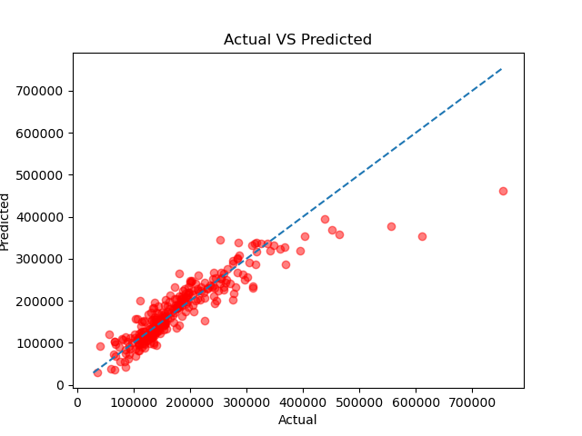

# House Prices: Multiple Linear Regression with Preprocessing

Predicting house sale prices using Multiple Linear Regression.
The main goal of this project is to practice correct data preprocessing
(missing values and categorical features) without data leakage.

## Dataset
[House Prices - Advanced Regression Techniques](https://www.kaggle.com/c/house-prices-advanced-regression-techniques)
(Ames, Iowa). Only `train.csv` is used, with 7 columns:
`SalePrice` (target), `GrLivArea`, `OverallQual`, `GarageArea`,
`LotFrontage`, `YearBuilt`, `Neighborhood`.
The data is not included in this repo. Download it from Kaggle and
place it in the `data/` folder.

## Steps
1. Load the data and inspect missing values
2. Split into train (80%) and test (20%) sets
3. Preprocess: impute missing numeric values, one-hot encode `Neighborhood`
   (fitted on the training set only)
4. Train a Linear Regression model
5. Evaluate on the test set and plot predicted vs actual prices

## Results
| Metric | Test value |
|--------|-----------|
| R²     | 0.815 |
| MAE    | 23,074 |
| RMSE   | 37,675 |



## Interpretation
  - one more square foot of `GrLivArea` is associated with about $49.5 higher predicted price;
  - a house built one year later is predicted to cost about $364 more;
  - a house in `BrDale` is predicted to cost about $27,000 less than a similar house
    in the baseline neighborhood.

## How to run
```bash
pip install -r requirements.txt
jupyter notebook notebook.ipynb
Developed and tested with Python 3.13.
```

## Tech
Python, pandas, scikit-learn, matplotlib